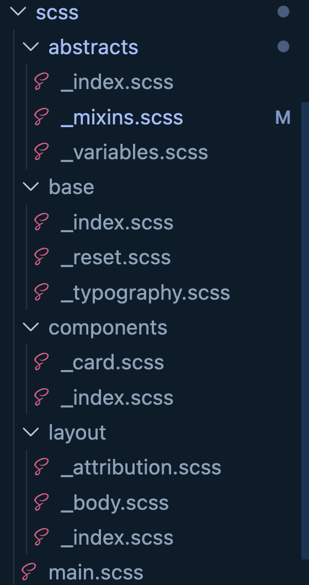

# Frontend Mentor - Product preview card component solution

This is a solution to the [Product preview card component challenge on Frontend Mentor](https://www.frontendmentor.io/challenges/product-preview-card-component-GO7UmttRfa). Frontend Mentor challenges help you improve your coding skills by building realistic projects. 

## Table of contents

- [Overview](#overview)
  - [The challenge](#the-challenge)
  - [Screenshot](#screenshot)
  - [Links](#links)
- [My process](#my-process)
  - [Built with](#built-with)
  - [What I learned](#what-i-learned)
  - [Continued development](#continued-development)
  - [Useful resources](#useful-resources)
  - [AI Collaboration](#ai-collaboration)
- [Author](#author)


## Overview

### The challenge

Users should be able to:

- View the optimal layout depending on their device's screen size

To create a responsive design, used a media query to switch from a flex column on mobile to a row on desktop.

- See hover and focus states for interactive elements

Added hover state to the button wit hover pseudo class on button.

### Screenshot


### Links

- [Solution URL](https://estebanrodriguez28.github.io/product-preview-card/)


## My process

Write html first, start with css base styles, them add css styles from top of the page down.

### Built with

- Semantic HTML5 markup
- Flexbox
- Mobile-first workflow
- SCSS 


### What I learned

SCSS or Sassy SCSS is a css pre preprocessor that allows us to create more organize css by splitting our css into several different files without losing performance. These files are called partials and they start with an underscore (_card.scss). Partials are not meant to be compiled to css, they can be used to create small scss code block in several scss files that can then be used in other scss files and then included in main.scss to be compiled to css.

SCSS is similar to css syntax but has some extended functionality. Structure I used was within a scss folder at root of project I have 4 folders. First is called abstracts holds the variables and mixins (blocks of css properties that can be reused). Second folder is called base has the resets and typography. Third folder is called components has the individual UI of the project (in this case there’s just one card). Fourth folder is called layout, has the major layouts of the page (body centering with flex, footer attribution). Lastly there is a main.scss file that uses all these folders with the @use sass rule, this file gets compiled to css. The html file uses the compiled css file.





  The main.scss in within the scss folder. Each folder has a _index.scss file which “forwards” all the scss files within that folder. 

```scss
// scss/base/_index.scss

@forward "reset";
@forward "typography";

```
  
Allowing us to use each scss folder (abstracts, base) in main without having to write out each scss file within the folder. By doing this our scss can be organized and easier to maintain.

```scss
// scss/main.scss

@use "base";
@use "components";
@use "layout";

```


I ran npm init so that I could set up a build script that lets me do npm run watch-sass instead of typing that command every time I want to compile scss to css and watch for changes. The -w or watch flag compiles the scss files to css every time you save a scss file so that you can see your updates in real time instead of saving your changes then running the command every time.
```json
"scripts": {
    "watch-sass": "sass -w scss/main.scss css/style.css",
    "run-sass": "sass scss/main.scss css/style.css"
  },
```


The picture tag in html can be used to define different images based on the device size. You can have one image for mobile then another image for desktop.

```html
<picture class="card__image-area">
<source srcset="images/image-product-desktop.jpg” media="(min-width:992px)” />

</picture>
```

Mixins allow us to specify css properties that can be reused such as centering with flex. This way we can reuse css without rewriting the same properties multiple times. Mixins are defined with the @mixin at rule, to use a mixin you use @include make sure to import the mixin from its folder (abstract) with @use relative to which file you are in. 

For example, below we are in _body.scss which is in the layout folder, the abstract folder containing the mixin scss file is one directory up from the file we are in (_body.scss) so you can do “../“ to go up one directory to the abstracts folder and use the mixin.

```scss
// scss/abstracts/_mixin.scss
@mixin flex-column-center {
  display: flex;
  flex-direction: column;
  justify-content: center;
  align-items: center;
}

// scss/layout/_body.scss

@use "../abstracts" as *;
body {
  @include flex-column-center;
  background-color: $cream;
  min-height: 100dvh;
  padding: 1rem;
}

```

Another useful way to use mixins is for media queries. I did mobile first, so only have media query for desktop but in larger projects could have for tablet as well.

```scss
// scss/abstracts/_mixin.scss
@mixin respond-to-desktop {
  @media screen and (min-width: $desktop) {
    @content;
  }
}

// scss/component/_card.scss

@use "../abstracts" as *;
.card {
  width: 100%;
  max-width: 37.5rem;
  display: flex;
  flex-direction: column;
  overflow: hidden;

  background-color: $white;
  border-radius: 10px;

  @include respond-to-desktop {
    flex-direction: row;
  }
}

```

Images by default are inline. Inline elements have extra space at the bottom to make room for “descenders”. Picture a lined notebook, when writing out words characters like a, l, or i can fit without going over the line below. However other characters like j, g, p go over the line known as “descenders”. More here: [Stack Overflow Explaining Issue](https://stackoverflow.com/questions/5804256/why-does-my-image-inside-a-div-have-extra-space-below-it). 

Inline elements make space for these “descenders” that can go over the baseline, the line the inline element is sitting on. Fix is to make the image a block element. A lot of css resets make images block elements so will do that in my reset from now on.

```scss
card__image {
    display: block;
    width: 100%;
}

```


Before I had added borders directly to the product image tag, targeting all images within the card component (like .card img on the img tags directly). However later on I add the cart icon svg file within an image tag. I was confused why is part of the icon being cut off? Answer was because I was targeting all image tags and adding a border. Fix was to give the product image its own class. 

> [!NOTE]
> This taught me a lesson that its not a good idea to target tags directly in css unless in a reset, cause this can cause effects you don't intend for the same tag later on. Good practice is to give everything a class, write selectors for the exact element you mean.

Once the product image had its own class, the cart icon no longer had those borders cutting off part of it. However Claude gave me a better solution. Instead of having border-radius defined in both the product image and the card class, instead could use the overflow hidden css property to clip any content that goes outside of the card. Making the image appear to have rounded corners while only having to define the border radius once in the card class.

```scss

.card {

  overflow: hidden;
  border-radius: 10px;
  &__image {
    display: block;
    width: 100%;
  }

   &__icon {
    width: 15px;
    height: 15px;
  }
```
The ampersand (&) can be used to nest classes within the parent (so the &__image is really just .card__image).

In the design, it appears that the image and the text area take up equal parts (both 50%) of the container. In searching for solution I came across flex the shorthand for flex-grow, flex-shrink, and flex-basis. Flex-grow determines how much of the remaning space in the flex container the flex items will take up, flex-shrink determines how much from the flex items will be removed to fit the flex container. Flex-basis determines the default size of a flex item before the remaining space is distributed. The default is flex: 0 1 auto. So by default flex items start out with whatever size they are given (auto).

Initially, a stackoverflow solution used the shorthand flex: 1 1 0, which should have made the flex items both have an initial size of 0, then the remaining space will be distributed equally to each flex item with flex-grow set to 1. So each flex item should be half of the container like the design. However, the flex item with all the text content had padding so it does not start at the initial size of 0 and ends up being larger than the image.

By setting each flex-item to have a flex-basis of 50%, each flex item’s starting value is 50% of the parent or flex container. Thus the image and the content area both take up 50% of the card.

```scss
  &__image-area {
    // Make the card's image and content the same size
    flex-basis: 50%;
  }

  &__content {
    display: flex;
    flex-direction: column;
    padding: 30px;
    gap: 20px;
    // Make the card's image and content the same size
    flex-basis: 50%;
  }
```

The ch unit in css can be used to more accurately control line breaks for text. One ch equals the size of the character 0 in that font, meaning whatever number you set ch to can limit the number of characters allowed per line before the word breaks to the next line.

```scss
&__title {
    font-family: $title-font;
    font-weight: 700;
    font-size: 1.8rem;
    @include respond-to-desktop {
      font-size: 2rem;
      max-width: 10ch;
    }
  }
```

The margin auto property can be used to move the price and cart button to the bottom of the card by taking all the available space at the bottom and adding that space to margin top. Note that auto can only be used for margin-top and margin-bottom in flexbox or grid, for a normal block element auto can only be used on margin-left and margin-right.
```scss
&__pricing {
    display: flex;
    align-items: center;
    gap: 10px;
    // Push the price and add cart button to bottom
    margin-top: auto;
  }

```

> [!Note]
> I was initially going to use flexbox properties (justify-content) to make the text spacing more similar to the design. However that was not necessary as I used gap property and styled the elements (the text content) itself to get closer to the design.


BEM is a naming convention for css. Standing for block, element, modifier. The block is a standalone/independent component or piece of UI such as a card. The element are the things or the “what" that makes up the block, defined by two underscores after the block element (.card__title, .card__text, .card__image). The element answers, what is this thing? Modifiers are used when you have different versions of the same element or thing, defined by two hyphens. Example of modifiers are button with different states or a different card version (.card—-featured, .card__button—-active).

Example modifier from this project. The price was an element within the block or card, but the crossed out price was the same “what” or had the same meaning as the price element. They are both price elements but the crossed out one styled differently so we can use a modifier describing that’s the previous price.
```scss
&__price {
    font-family: $title-font;
    font-weight: 700;
    color: $green-500;
    font-size: 1.75rem;

    &--previous {
      font-family: $body-font;
      color: $grey;
      font-weight: 500;
      font-size: 0.8rem;
    }
  }

```

> [!NOTE]  
> While using BEM I kept naming elements based on their appearance instead of their role. The appearance of an element may change (previous price might be come a different color) but the role will likely stay the same (element still represents the previous price). Name elements based on what they are/mean instead of appearance.

Another example where I used appearance to name something instead of a role was the fonts. Before I named the font variables exactly what the fonts were. By naming fonts based on what they represent, can change specific font while not losing meaning.

```scss
// scss/abstracts/_variables.scss
$body-font: Montserrat, sans-serif;
$title-font: Fraunces, serif;
```

With BEM you always write elements one level down from the block element (block__element) you should not nest further down no matter how nested an element may be in the html (block__outer-element__inner-element). An example you might want to do this is if a icon is within a button (card__button__icon). But what if the icon is moved outside of the button in the html? Then that name is no longer accurate, however if each element is always tied directly to the block (card__icon) the html can move around while name remains accurate

Another reason is that creating BEM classes that are too nested are easy to mistype so classes should always be the block element followed by two underscores then the element.

> [!NOTE]  
> BEM classes should always be the block element followed by two underscores then element (block__element). No matter how deep the element may be nested in the html, don’t nest elements further from the block (block__element1__element2) as will be harder to maintain.

By using BEM we can create more standardized css classes that are easier to maintain, understand, and scale. Combined with scss we can make css much more organized and modular.

This project took me two days more than my original due date that I set, I wrote the date down that I wanted to finish before starting. This was due to several factors. One was at the end I decided to implement BEM in my css without any experience with BEM before. Next I also had very little experience with scss so organizing the folders and figuring out which files to create took some time to understand. But most of all was reading documentation to try to understand why certain things were happening. Such as why inline elements have that space at the bottom, how to divide space in a flex container among flex items with flex shorthand. Spent a lot of time on MDN docs and going through why css behaves a certain way with Claude where maybe that time should have been cut shorter and more focused on the solution.

> [!IMPORTANT]  
> Ask yourself is this the best use of my time? Is this getting me closer to a solution? Sometimes I read through documentation or articles to understand something but did not get closer to a solution and could not recall that information later on. Read documentation with intention. Write due date for the project down or keep it somewhere you can see. If you miss a deadline, reflect why.

Project management is a skill that will get better over time, I expect the next projects to be much quicker as now I know fundamental css organization techniques (like BEM, SCSS) that I felt were worth investing time into learning early so I can implement them in each project I do. As far as time spent reading documentation and trying to understand why things behave certain ways in css or html, I feel that’s worth investing time into for sure but also not so much that I miss my own deadlines. 


### Continued development

In future projects I would like to hone in more my scss and BEM skills. I would also like to learn grid and the advantages over flexbox. I still have some difficulty understanding how flexbox fully works, in future projects would like more practice as how flex items actually take up space and how to manipulate flex properties to get the design you want in the clearest way possible.


### Useful resources

- [BEM Explained](https://markodenic.com/bem-css/) - This helped me understand how to use BEM what block, element, modifier mean.
- [SCSS Folder Structure]([https://www.example.com](https://dev.to/joxx/creating-an-organized-scss-file-structure-5dca)) - This article helped me out to structure my scss
- [Flex shorthand](https://developer.mozilla.org/en-US/docs/Web/CSS/Guides/Flexible_box_layout/Controlling_flex_item_ratios) - This article explained how to use flex shorthand and each property (flex-grow, flex-shrink, flex-basis)
- [Markdown Shortcuts for README](https://github.com/tchapi/markdown-cheatsheet/blob/main/README.md) - This GitHub repository contains some useful Markdown shortcuts for creating README files


### AI Collaboration

I used Claude for explaining concepts, where I found it most useful is to give me feedback. Helping me find more efficient css and understanding when to reach for certain properties.


## Author
- Frontend Mentor - [@estebanrodriguez28]([https://www.frontendmentor.io/profile/yourusername](https://www.frontendmentor.io/profile/estebanrodriguez28))


