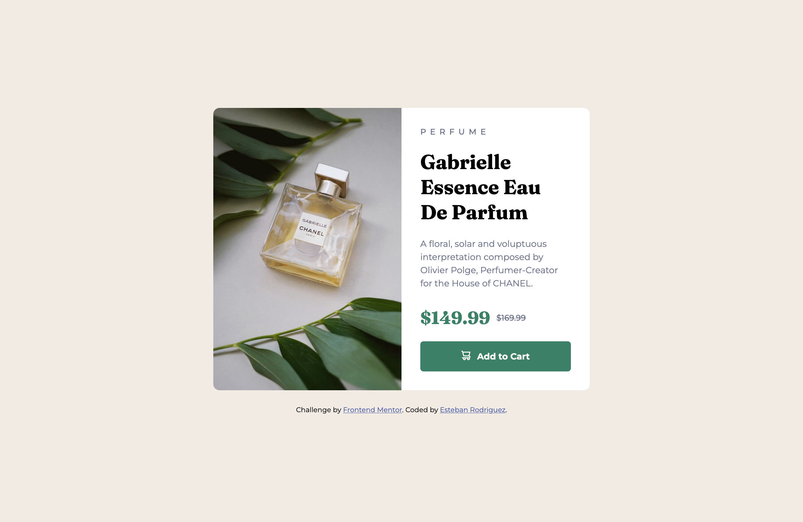
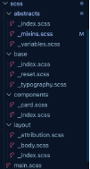

# Frontend Mentor - Product preview card component solution

This is a solution to the [Product preview card component challenge on Frontend Mentor](https://www.frontendmentor.io/challenges/product-preview-card-component-GO7UmttRfa). Frontend Mentor challenges help you improve your coding skills by building realistic projects. 

## Table of contents

- [Overview](#overview)
  - [The challenge](#the-challenge)
  - [Screenshot](#screenshot)
  - [Links](#links)
- [My process](#my-process)
  - [Built with](#built-with)
  - [What I learned](#what-i-learned)
  - [Continued development](#continued-development)
  - [Useful resources](#useful-resources)
  - [AI Collaboration](#ai-collaboration)
- [Author](#author)
- [Acknowledgments](#acknowledgments)

**Note: Delete this note and update the table of contents based on what sections you keep.**

## Overview

### The challenge

Users should be able to:

- View the optimal layout depending on their device's screen size
- See hover and focus states for interactive elements

### Screenshot




### Links

- [Solution URL](https://estebanrodriguez28.github.io/product-preview-card/)


## My process

Write html first, start with css base styles, them add css styles from top of the page down.

### Built with

- Semantic HTML5 markup
- Flexbox
- Mobile-first workflow
- SCSS 


### What I learned

SCSS or Sassy SCSS is a css pre preprocessor that allows us to create more organize css by splitting our css into several different files without losing performance. These files are called partials and they start with an underscore (_card.scss). Partials are not meant to be compiled to css, they can be used to create small scss code block in several scss files that can then be used in other scss files and then included in main.scss to be compiled to css.

SCSS is similar to css syntax but has some extended functionality. Structure I used was within a scss folder at root of project I have 4 folders. First is called abstracts holds the variables and mixins (blocks of css properties that can be reused). Second folder is called base has the resets and typography. Third folder is called components has the individual UI of the project (in this case there’s just one card). Fourth folder is called layout, has the major layouts of the page (body centering with flex, footer attribution). Lastly there is a main.scss file that uses all these folders with the @use sass rule, this file gets compiled to css. The html file uses the compiled css file.





  The main.scss in within the scss folder. Each folder has a _index.scss file which “forwards” all its memebers. Allowing us to use each scss folder (abstracts, base) in main without having to write out each scss file within the folder. By doing this our scss can be organized and easier to maintain.


I ran npm init so that I could set up a build script that lets me do npm run watch-sass instead of typing that command every time I want to compile scss to css and watch for changes. The -w or watch flag compiles the scss files to css every time you save so that you can see your updates in real time instead of saving your changes then running the command every time.
```json
"scripts": {
    "watch-sass": "sass -w scss/main.scss css/style.css",
    "run-sass": "sass scss/main.scss css/style.css"
  },
```


The picture tag in html can be used to define different images based on the device size. You can have one image for mobile then another image for desktop.

```html
<picture class="card__image-area">
<source srcset="images/image-product-desktop.jpg” media="(min-width:992px)” />

</picture>
```

Mixins allow us to specify css properties that can be reused such as centering with flex. This way we can reuse css without rewriting the same properties multiple times. Mixins are defined with the @mixin at rule, to use a mixin you use @include make sure to import the mixin from its folder (abstract) with @use relative to which file you are in. 

For example, below you are in _body.scss which is in the layout folder, the abstract folder containing the mixin scss file is one directory up from the file we are in (_body.scss) so you can do “../“ to go up one directory to the abstracts folder and use the mixin.

```scss
// scss/abstracts/_mixin.scss
@mixin flex-column-center {
  display: flex;
  flex-direction: column;
  justify-content: center;
  align-items: center;
}

// scss/layout/_body.scss

@use "../abstracts" as *;
body {
  @include flex-column-center;
  background-color: $cream;
  min-height: 100dvh;
  padding: 1rem;
}

```

Another useful way to use mixins is for media queries. I did mobile first, so only have media query for desktop but in larger projects could have for tablet as well.

```scss
// scss/abstracts/_mixin.scss
@mixin respond-to-desktop {
  @media screen and (min-width: $desktop) {
    @content;
  }
}

// scss/component/_card.scss

@use "../abstracts" as *;
.card {
  width: 100%;
  max-width: 37.5rem;
  display: flex;
  flex-direction: column;
  overflow: hidden;

  background-color: $white;
  border-radius: 10px;

  @include respond-to-desktop {
    flex-direction: row;
  }
}

```

Images by default are inline. Inline elements have extra space at the bottom to make room for “descenders”. Picture a lined notebook, when writing out words characters like a, l, or i can fit without going over the line below. However other characters like j, g, p go over the line known as “descenders”. More here [Stack Overflow Explaining Issue](https://stackoverflow.com/questions/5804256/why-does-my-image-inside-a-div-have-extra-space-below-it). Inline elements make space for these “descenders” that can go over the baseline, the line characters are sitting on or the line the inline element is sitting on. Fix is to make the image a block element. A lot of css resets make images block elements so will do that in my reset from now on.

```scss
card__image {
    display: block;
    width: 100%;
}

```


Before I had added borders directly to the product image tag, targeting all images within the card component. However later on I add the cart icon svg file within an image tag. I was confused why is part of the image being cut off? Answer was because I was targeting all image tags and adding a border. Fix was to give the product image its own class. This taught me a lesson that its not a good idea to target tags directly in css unless in a reset, cause this can cause effects you don't intend for the same tag later on. Good practice is to give everything a class, write selectors for the exact element you mean.

Once the product image had its own class, the cart icon no longer had those borders cutting off part of it. However Claude gave me a better solution. Instead of having border-radius defined in both the product image and the card class, instead could use the overflow hidden css property to clip any content that goes outside of the card. Making the image appear to have rounded corners while only having to define the border radius once in the card class.

```scss

.card {

  overflow: hidden;
  border-radius: 10px;
  &__image {
    display: block;
    width: 100%;
  }

   &__icon {
    width: 15px;
    height: 15px;
  }
```
The ampersand (&) can be used to nest classes within the parent (so the &__image is really just .card__image).

In the design, it appears that the image and the text area take up equal parts (both 50%) of the container. In searching for solution I came across flex the shorthand for flex-grow, flex-shrink, and flex-basis. Flex-grow determines how much of the remaning space in the flex container the flex items will take up, flex-shrink determines how much from the flex items will be removed to fit the flex container. Flex-basis determines the default size of a flex item before the remaining space is distributed. The default is flex: 0 1 auto. So by default flex items start out with whatever size they are given (auto).

Initially, a stackoverflow solution used the shorthand flex: 1 1 0, which should have made the flex items both have an initial size of 0, then each grow the same amount to take up the space (thus each flex item takes up 50% of the container). However, the flex item with all the text content had padding so it does not start at the initial size of 0, ends up being larger than the image.

By setting each flex-item to have a flex-basis of 50%, each flex item’s starting value is 50% of the parent or flex container. Thus the image and the content area both take up 50% of the card.

```scss
  &__image-area {
    // Make the card's image and content the same size
    flex-basis: 50%;
  }

  &__content {
    display: flex;
    flex-direction: column;
    padding: 30px;
    gap: 20px;
    // Make the card's image and content the same size
    flex-basis: 50%;
  }
```

```js
const proudOfThisFunc = () => {
  console.log('🎉')
}
```

If you want more help with writing markdown, we'd recommend checking out [The Markdown Guide](https://www.markdownguide.org/) to learn more.

**Note: Delete this note and the content within this section and replace with your own learnings.**

### Continued development

Use this section to outline areas that you want to continue focusing on in future projects. These could be concepts you're still not completely comfortable with or techniques you found useful that you want to refine and perfect.

**Note: Delete this note and the content within this section and replace with your own plans for continued development.**

### Useful resources

- [Example resource 1](https://www.example.com) - This helped me for XYZ reason. I really liked this pattern and will use it going forward.
- [Example resource 2](https://www.example.com) - This is an amazing article which helped me finally understand XYZ. I'd recommend it to anyone still learning this concept.

**Note: Delete this note and replace the list above with resources that helped you during the challenge. These could come in handy for anyone viewing your solution or for yourself when you look back on this project in the future.**

### AI Collaboration

Describe how you used AI tools (if any) during this project. This helps demonstrate your ability to work effectively with AI assistants.

- What tools did you use (e.g., ChatGPT, Claude, GitHub Copilot)?
- How did you use them (e.g., debugging, generating boilerplate, brainstorming solutions)?
- What worked well? What didn't?

**Note: Delete this note and the content above if you didn't use AI, or replace with your own experience.**

## Author

- Website - [Add your name here](https://www.your-site.com)
- Frontend Mentor - [@yourusername](https://www.frontendmentor.io/profile/yourusername)
- Twitter - [@yourusername](https://www.twitter.com/yourusername)

**Note: Delete this note and add/remove/edit lines above based on what links you'd like to share.**

## Acknowledgments

This is where you can give a hat tip to anyone who helped you out on this project. Perhaps you worked in a team or got some inspiration from someone else's solution. This is the perfect place to give them some credit.

**Note: Delete this note and edit this section's content as necessary. If you completed this challenge by yourself, feel free to delete this section entirely.**

